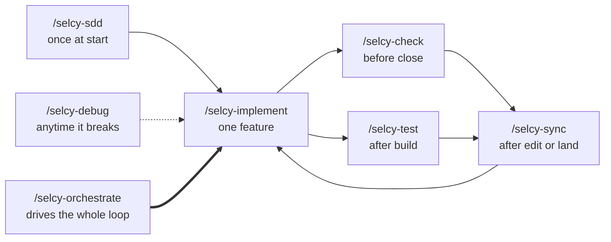

# skills

A collection of [Agent Skills](https://agentskills.io/) for spec-driven development and build automation, built for any AI coding agent.

One repo, two categories. `skills/software-engineer/` holds the spec-driven loop: interview once, then build one feature per chat. `skills/orchestrator/` holds the automation that drives that loop unattended. They are independent — use only the ones a change needs.

## The loop



Read it as a contract: `/selcy-sdd` runs **once** and writes the spec bundle. Everything after that runs **per feature**, in its own new chat. `/selcy-debug` runs anytime, out of band. `/selcy-orchestrate` replaces the human in the per-feature loop, once, after you approve the plan.

## The skills

One skill per phase. Run only the ones a change needs.

| Skill | Category | What it does |
| --- | --- | --- |
| `selcy-sdd` | software-engineer | Run `/selcy-sdd` once at project start. Interviews you in structured rounds (product, stack, architecture shape, security, error handling, testing, deployment), then batch generates the whole spec-driven development context bundle plus numbered feature specs. Safe to resume in a new chat. |
| `selcy-implement` | software-engineer | Run `/selcy-implement` to build one feature spec into working code. Reads the context bundle, gates on input coverage so nothing load bearing is invented mid build, builds, runs the spec's Check When Done, updates progress-tracker.md, and commits. One feature per chat. |
| `selcy-check` | software-engineer | Run `/selcy-check` before closing a feature. `verify` runs the real app and proves the feature behaves per its spec; `review` reads the diff on a fresh model and ranks findings. Read only, never edits code. |
| `selcy-test` | software-engineer | Run `/selcy-test` after `/selcy-implement` builds a feature. Scopes from git uncommitted changes, reads the testing standards to know what must be covered first, and picks the right strategy per file. Saves the framework choice so it never asks twice. |
| `selcy-debug` | software-engineer | Run `/selcy-debug` when something is broken. Reproduces the bug on demand, narrows it to the smallest failing surface, fixes the root cause with the smallest change, and hands a regression test to `/selcy-test`. |
| `selcy-sync` | software-engineer | Run `/selcy-sync` after you edit a context file by hand, or after a feature lands. Reconciles progress-tracker.md against the repo, detects a context file that drifted from the feature specs, and flags specs the change made stale. |
| `selcy-orchestrate` | orchestrator | Run `/selcy-orchestrate` after `/selcy-sdd` and you approve the plan. Reads progress-tracker.md, delegates one feature at a time to `opencode run`, verifies against the spec's Check When Done, and advances. Unattended, stops only on an owed decision or a failed gate. |

---

## Install

Uses [npx skills](https://github.com/vercel-labs/skills). Pick your agent:

```bash
# Claude Code (installs into .claude/skills, then restart Claude Code)
npx skills@latest add maulanaadib/skills -a claude-code

# OpenCode, Codex, and other .agents/skills readers
npx skills@latest add maulanaadib/skills -a opencode

# GitHub Copilot
npx skills@latest add maulanaadib/skills -a github-copilot

# Any other supported agent, or all of them
npx skills@latest add maulanaadib/skills -a cursor
npx skills@latest add maulanaadib/skills --all
```

Or install from the full URL:

```bash
npx skills@latest add https://github.com/maulanaadib/skills
```

List what is inside before installing:

```bash
npx skills@latest add maulanaadib/skills --list
```

**One trade-off to know.** `npx skills add` copies every skill in the repo, so each agent receives all seven even if it will only use a few. The unused ones sit idle; a skill never loads unless its trigger fires. This is the cost of keeping unrelated skills in one repo instead of one repo per skill.

The orchestrator has an extra step the other six do not. It needs a Hermes profile and the kanban toolset, because the dispatcher is what spawns it. If you only want the spec-driven loop, install with `-a opencode` and never set up Hermes; `selcy-orchestrate` will not fire. Full walkthrough: **[docs/orchestrator-runbook.md](docs/orchestrator-runbook.md)**.

---

## How to use each skill

### `/selcy-sdd` — the bootstrap

**Run once, at project start.** Never again for the same project.

It interviews you across every dimension a builder would otherwise invent, in batched decision panels of up to 4 questions each. Every panel has exactly one `(recommended)` option with a one line why, so you can override or accept. Then it writes the whole bundle in one pass.

The interview works a **design tree**, not a checklist. Every decision branches into the decisions that hang off it. Each round asks the whole **frontier**: every question whose prerequisites are already settled, so you are never asked something that hinges on an answer it has not heard yet. A question that depends on another question still open belongs to a later round. The stages are the dimensions the tree must eventually cover, not a script: ask what is ready, not what is next.

The interview stages:

| Stage | What it settles |
| --- | --- |
| 0. Framing | Product name, doc language, MVP boundary, audience, monetization, success metric, hard constraints |
| 1. Capabilities | Auth, payments, search, realtime, and 8 more. In this build or deferred? |
| 2. Cross cutting | SEO, performance, analytics, accessibility, legal and compliance |
| 3. Stack | Language, framework, database, ORM, auth, storage, hosting, testing |
| 3b. Architecture shape | Monolith vs microservices, module boundaries, split triggers, dependency direction |
| 3c. Security | Auth and session, authorization model, input validation, secrets, compliance scope, data protection |
| 3d. Error handling | Error response shape, error categories, logging, observability, user facing errors |
| 3e. Testing | Runners, test pyramid, what is tested first, definition of done |
| 4. UI direction | Theme mode, color direction, typography, component foundation |
| 5. Code standards | Type strictness, file organization, testing strategy, git workflow |
| 5b. Repository | GitHub repo URL, branch strategy, commit cadence |
| 5c. Deployment and CI | Deploy target, trigger, CI checks, env var convention |
| 6. Approach and tier | Build approach, workflow tier |
| 7. Features | The ordered feature list, each with intent and done-when |

Two rules about the interview:

- **It is complete when every dimension is answered, inferred with the inference stated back to you, or marked not applicable with a reason.** A short interview is a red flag. A real project spans many dimensions.
- **It ends with one confirmation round**: the full plan shown back for approval. Only after you approve does generation start.

**Commands:**

```bash
/selcy-sdd              # fresh: full interview, then generate everything
/selcy-sdd resume       # continue after a chat died mid-interview
/selcy-sdd specs        # regenerate every feature spec from current state
/selcy-sdd specs 04-debt-entry   # regenerate or add one feature spec only
/selcy-sdd context      # regenerate only the context files plus AGENTS.md
```

**What it writes:**

```text
context/
  AGENTS.md                  # the read order, the entry point every later chat reads first
  product-context.md         # the why: problem, users, success metrics, non goals
  project-overview.md        # the what: product definition, goals, features, scope
  progress-tracker.md        # current phase, completed work, open questions, next steps
  architecture-context.md    # stack, system boundaries, storage model, invariants, env vars
  architecture-standards.md  # architecture style, module boundaries, when to split
  security-standards.md      # auth, authorization, validation, secrets, compliance
  error-handling.md          # error contract, logging, observability
  testing-standards.md       # test pyramid, what is tested first, definition of done
  data-model.md              # canonical entities, indexes, migration rules
  ui-context.md              # theme, colors, typography, component conventions
  code-standards.md          # implementation rules and conventions
  ai-workflow-rules.md       # development workflow, scoping rules, delivery approach
  feature-specs/
    00-project-setup.md      # scaffold, boilerplate cleanup, repo, first deploy
    NN-name.md               # one per feature
  .sdd-state.md              # resume state, internal, dot prefixed
```

**The two rules the whole bundle is shaped for:**

- **One feature spec per chat.** Never two. This is what keeps a mistake in one chat from touching the others, and what makes each chat cheap to throw away and redo.
- **Progress lives in `progress-tracker.md`, never in chat memory.** If it is not written to that file, the next chat does not know it happened.

### `/selcy-implement` — the builder

**Run once per feature, in a new chat.**

It turns one feature spec into working code. Nothing else in the bundle is in scope for that chat.

**Commands:**

```bash
/selcy-implement              # build the current feature (from progress-tracker.md)
/selcy-implement 04           # build feature 04, matched on the number prefix
/selcy-implement debt-entry   # build it, matched on a name fragment
/selcy-implement rework 02    # rebuild a feature already marked Completed (asks first)
```

**What it does, in order:**

1. Reads `progress-tracker.md`, resolves the feature, says which one and how.
2. Reads `AGENTS.md` and follows its read order exactly, then the one feature spec. It does **not** read other feature specs.
3. **The input coverage gate.** Before writing any code, it enumerates every value the build must produce and checks each against the bundle for a named source. Any required value with no named source is an owed decision, and it stops and asks rather than inventing.
4. Builds, treating the standards files as contracts. A feature may add to them, never relax them. If a spec contradicts a standards file, the standards file wins.
5. Runs the spec's `## Check When Done`, then lint, typecheck, and tests.
6. Updates `progress-tracker.md` per the spec's `## Progress Tracker` section.
7. Commits per the spec's `## Commit and Push` section, asking which branch first.

**The gate is the point.** A build model rationalizes a real decision as "just wiring" and waves it through. The gate is mechanical, not intuitive: enumerate the values, check each against the bundle. That is what stops a builder from inventing a money rule or a permission model mid feature.

### `/selcy-check` — the gate before done

**Run before you call a feature done.**

Green tests do not close a feature. A test suite proves the code does what the tests say; `verify` proves the tests say what the spec says.

**Commands:**

```bash
/selcy-check             # no mode word → it shows the options and stops, never guesses
/selcy-check verify      # run the real app, prove it against the spec
/selcy-check review      # fresh model senior read of the diff, ranked findings
/selcy-check both        # verify first, then offer review
```

**`verify` mode** runs the real app, not a mock or a dry run. For each `## Check When Done` item it exercises the behavior and reports pass or fail with what it actually observed. "Should work" is not a result. It also checks the surfaces the spec names that no checklist item covers: a page that must render, a state the spec lists (loading, empty, error, success).

**`review` mode** spawns a reviewer on a **different model than the one that wrote the code**, because a model reviewing its own output shares its own blind spots. Findings are ranked by severity (blocks close, should fix before close, nit) and written to `context/.reviews/<feature>.md`. Findings that contradict a standards file the code correctly follows are dropped: the standards file is the contract, not the reviewer's taste.

**Both modes are read only.** Neither edits code, and neither marks a feature Completed. A failure points at `/selcy-debug` if it is a bug, or `/selcy-implement` if it is work the feature still owes.

### `/selcy-test` — the test suite

**Run after `/selcy-implement` builds a feature.**

A senior test engineer writing the suite the code deserves. Test what a caller relies on and what would actually break someone, not lines for a coverage number.

**Commands:**

```bash
/selcy-test              # scopes from your git working tree, no scope question
```

**What it does, in order:**

1. Reads `context/testing-standards.md` first, because that file already decided what this project must test first (anything doing money, auth, or permissions), which runners to use, and what done means. It does not rederive those choices per feature.
2. Determines scope from git: changed but uncommitted files. The working tree decides; it never asks a scope question. More than 15 files → it asks whether to scope to the feature's own area.
3. Classifies each changed file and picks the right strategy:

   | File type | Strategy |
   | --- | --- |
   | Pure logic (utils, money, timezone) | Unit tests, and the edge cases are the point: zero, negative, boundary, rounding, overflow, timezone boundaries |
   | Component (UI) | Render it, assert on its states (loading, empty, error, success), keyboard interaction where it owns any |
   | API route or server action | Call it, assert the response shape `error-handling.md` defines, cover the error categories it lists |
   | Page or flow | E2E or integration test of the whole path; the only place an E2E runner earns its cost |

4. Traces each test to a `## Check When Done` item or a standards file requirement. A test with no traceable source is either scope creep or a sign the spec missed something; it says which.
5. Writes the tests next to the code, following the project's existing test layout.
6. Runs the suite, or hands back the exact commands.

It saves your framework choice to `test-preferences.json` so it never asks twice. It never fixes application code: a red test is a report, not a repair. It also refuses to write tests that lock in scaffolding the feature was never meant to make real.

### `/selcy-debug` — the investigator

**Run anytime something is broken.** Out of band, no feature context needed.

A bug is a case to be proven, not a guess to be patched. It runs a disciplined loop: reproduce → localize → hypothesize one at a time → fix the root cause → verify → hand off a regression test.

**Commands:**

```bash
/selcy-debug
```

**How to report a bug to it.** It needs three things, and the better you give it, the faster it converges:

```bash
/selcy-debug

Observed: pembayaran 15000 ke utang 10000 malah tersimpan, saldo jadi -5000
Expected: ditolak. Spec 05-debt-payment.md "Invariants" bilang
          "Total pembayaran tidak boleh melebihi debt.amountSen"
Reproducible: login → buka customer detail → catat pembayaran 15000
              di utang yang saldonya 10000. Terjadi setiap kali.
```

| Field | What it wants |
| --- | --- |
| **Observed** | The exact error, stack trace, wrong output, or screenshot |
| **Expected** | What should happen, **and the source that says so**: a spec section, a standards file, or a `Check When Done` item |
| **Reproducible** | The exact steps that trigger it, every time or intermittently |

Naming the source in **Expected** matters. If no source names the expected behavior, that is an owed decision and the bug is partly a spec gap; it says so rather than patching around it.

**The loop it runs:**

1. **Reproduce** on demand, before anything else. If it cannot, it asks for the missing detail instead of guessing at a fix.
2. **Localize** to the smallest failing surface: the whole app, the feature, the module, the function, the line.
3. **Hypothesize, one at a time.** It forms one hypothesis, designs the cheapest test that would confirm or reject it, runs it. Rejected is real progress. It never holds two hypotheses at once, and never fixes before one is confirmed.
4. **Fix the root cause** with the smallest change. Not the symptom: if the cause is a missing validation, the fix adds the validation, it does not catch the resulting error downstream. One change, then verify.
5. **Verify** both that the bug no longer reproduces **and** that the feature's `Check When Done` still passes. A fix that silences the bug and breaks the feature is not a fix.
6. **Hand off a regression test** to `/selcy-test`, or write one inline. A bug fixed without one is a bug that can come back unnoticed.

It never fixes a symptom it cannot explain, never stacks changes until something works, never refactors unrelated code while in there, and never adds a feature even one the bug obviously suggests.

**One important behavior:** if the bug reveals a flawed decision rather than a coding mistake, it points at `/selcy-sdd specs <feature>` rather than papering over it. A bug caused by a wrong standards file is not fixed by editing code around it.

### `/selcy-sync` — the honesty check

**Run after you edit a `context/` file by hand, or after a feature lands.**

The bundle is a set of contracts. A standards file is a contract every feature spec inherits. When you edit one by hand, every spec that depends on it is now potentially stale, and the next `/selcy-implement` chat will read a spec whose details no longer match the standards it is supposed to follow. This skill is what catches that.

**Commands:**

```bash
/selcy-sync              # reconcile everything, in order
/selcy-sync stale        # only the drift check; fast, see what a manual edit broke
/selcy-sync progress     # only the progress-tracker reconciliation
```

**What it does, in order:**

1. **Reconcile `progress-tracker.md`** against the repo. For each feature: Completed → verify the evidence exists (code, tests, commit). In Progress → verify the work is partway. Next Up → verify nothing in the repo already built it. It corrects a cell, never rewrites the file, and flags unexpected state instead of clobbering it.
2. **Drift check** — the reason this skill exists. For each standards file, it compares it against every feature spec that references it:

   | Standards file | What it checks |
   | --- | --- |
   | `architecture-standards.md` | Does any spec place its feature in a module this file no longer names, or cross a boundary it no longer allows? |
   | `security-standards.md` | Does any spec describe an auth, authorization, or validation approach this file contradicts? |
   | `error-handling.md` | Does any spec define an error shape or category this file no longer defines? |
   | `testing-standards.md` | Does any spec promise tests this file no longer requires? |
   | `data-model.md` | Does any spec reference an entity, column, or index this file changed or removed? |
   | `architecture-context.md` | Does any spec name a stack entry, invariant, or env var this file no longer has? |

   For each drift found, it reports the file and line that changed, the spec and section that now contradicts it, and the exact `/selcy-sdd specs <feature>` command to fix it.

3. **Flag what it must not touch**: curated prose you wrote by hand, a spec whose feature is In Progress (syncing mid build would change the contract under the builder), and the feature list itself.

**It never rewrites a feature spec, even one it found stale.** It detects and reports. Regenerating is `/selcy-sdd`'s job, because regeneration may surface a new owed decision that needs a round.

**The full flow after editing a standards file:**

```bash
# 1. You edit error-handling.md by hand (say, adding a RATE_LIMITED category)

/selcy-sync              # 2. detect: which specs did that make stale?

/selcy-sdd specs 04-debt-entry   # 3. regenerate each stale spec
                                  #    (sync tells you the exact commands)
```

Skip step 2 only when you already know which features your edit touches. Run it when you do not. Editing `error-handling.md` touches every feature, since every server action uses the contract, so that is a case where sync is the safety net that matters.

### `/selcy-orchestrate` — the unattended loop

**Run after `/selcy-sdd` and you approve the plan.** It replaces the human in the per-feature loop.

The loop is deliberately one feature per chat, and a human opening a new chat per feature is the bottleneck on a seven feature project. The loop's safety does not come from the human being present each time; it comes from the contract being in the files. This skill drives that loop mechanically, and stops the moment the contract cannot answer a question.

**Prerequisites.** All four must be true, or it stops and says which one is missing:

1. A `context/` bundle exists in the project directory, written by `/selcy-sdd`.
2. `context/progress-tracker.md` names a current goal that is a feature spec in `context/feature-specs/`.
3. `opencode` is on PATH and can run in the project directory.
4. The kanban toolset is enabled on the Hermes profile.

It never creates a bundle, never edits the feature list, and never runs `/selcy-sdd`. If the bundle is missing, that is a human decision about what to build.

**The loop it runs:**

1. **Read `progress-tracker.md`.** Current Phase, Current Goal, Completed, In Progress. The file is the only source of truth; the orchestrator forgets between turns.
2. **Delegate one feature.** One feature per card, chained in order so a failure stays contained.
3. **Wait.** Never background it, never time it out and move on.
4. **Verify.** Green output is a claim, not proof. It checks the spec's `## Check When Done` against the builder's output, and re-reads the tracker to confirm the builder itself moved the feature to Completed.
5. **Advance.** If it passed, loop to step 1 for the next feature.
6. **Stop.** If it failed, or the builder asked a question the bundle does not answer, it stops and reports. Never retries blindly, never answers an owed decision, never edits the spec to make a failure go away.

**The three stop conditions:**

| Kind | What happened | What it surfaces |
| --- | --- | --- |
| **Failed** | The build errored | The error and the spec section it was working on |
| **Owed decision** | The builder asked a question the bundle does not answer | The question verbatim. It never answers it, never picks the recommended option on your behalf |
| **Gate mismatch** | The builder claimed done but a `Check When Done` item is unaddressed, or the tracker did not advance | Which item |

A single feature failure stops the loop, because the next feature may be built on a broken foundation.

**What it never does:** never writes application code, never edits a file under `context/`, never answers an owed decision, never batches features, never marks a feature complete, and never runs the other six skills itself.

Full setup walkthrough: **[docs/orchestrator-runbook.md](docs/orchestrator-runbook.md)**.

---

## A full feature cycle

One feature, one chat, start to close:

```bash
# New chat. Build one feature.
/selcy-implement 03

# It builds, runs Check When Done, updates progress-tracker.md, commits.

# Write the suite for what just changed.
/selcy-test

# Prove it against the spec, on the real app.
/selcy-check verify

# Close the chat. Open a new one. Next feature.
/selcy-implement 04
```

Something breaks at any point:

```bash
/selcy-debug
```

You edit a context file by hand:

```bash
/selcy-sync
```

You want the whole build unattended after approving the plan:

```bash
/selcy-orchestrate
```

## Why this exists

The `/scope` and `/architect` style of skill is deliberately one decision at a time. That is correct for a living project, but expensive at project start, when you want the whole context bundle written once and then forgotten about. `/selcy-sdd` front loads the interview, then batch writes.

It also closes the gaps where a builder most often hallucinates: security rules, architecture shape, the error contract, the testing contract, the data model, money and timezone handling, and the environment variable list. Each is decided once, written to a standards file, and inherited by every feature spec.

The seven skills exist because each is a distinct job with a distinct contract, and mixing them is what causes the failures they prevent: a builder that reviews its own code shares its own blind spots (`selcy-check`), a test suite that proves the tests but not the spec (`selcy-check verify`), a fix that silences a symptom without explaining it (`selcy-debug`), a standards edit that silently invalidates specs nobody regenerates (`selcy-sync`), and a human bottleneck the loop does not actually need (`selcy-orchestrate`).

## Requirements

Any Agent Skills client: Claude Code, OpenCode, Codex, Cursor, GitHub Copilot, Gemini CLI, Windsurf, and [75 more](https://agentskills.io/clients). No runtime, no service, no tokens. `git` is the only required CLI for the six spec-driven skills, used by `/selcy-test`, `/selcy-check review`, and `/selcy-sync`.

`/selcy-orchestrate` is the exception. It additionally requires a Hermes profile with the kanban toolset and `opencode` on PATH. See **[docs/orchestrator-runbook.md](docs/orchestrator-runbook.md)**.

## License

MIT
